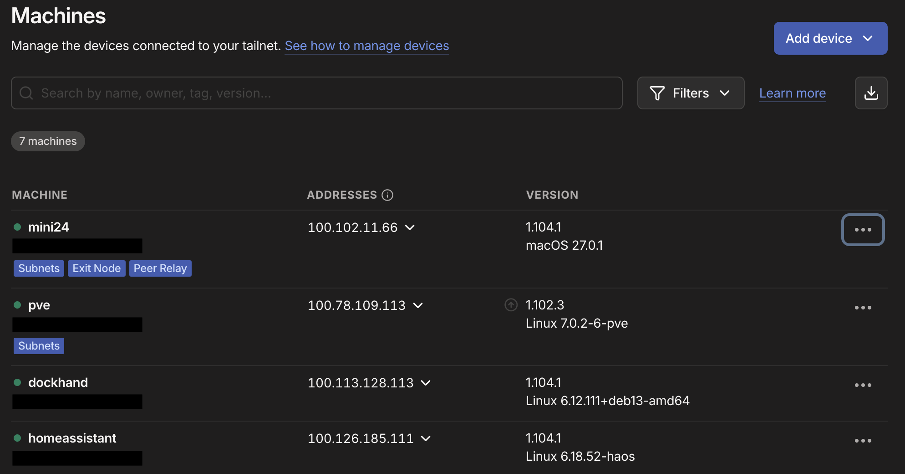
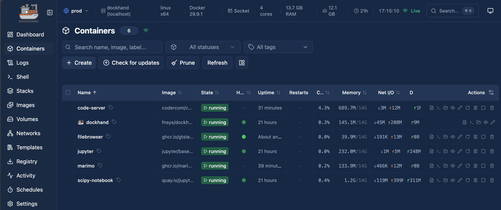

# Selfhost Homelab: Tailscale & Dockhand

Personal homelab setup connecting a Proxmox VE hypervisor, Home Assistant, and a dedicated Docker VM managed via Dockhand, all securely exposed over Tailscale without open ports.

---

## 1. Tailscale Mesh & Subnet Routing



- **Subnet Routing**: The Proxmox VE hypervisor (`pve`) advertises local LAN/VM subnets, granting any device on the tailnet direct access to internal VM bridges, hypervisor consoles, and Home Assistant (`haos`) without port forwarding.
- **Dedicated Docker VM**: The `dockhand` node runs on Proxmox to host containerized dev and data science environments.

---

## 2. Request Flow & Implementation

Tailscale Serve terminates HTTPS at the tailnet domain and directs traffic to Caddy, which routes subpaths to individual container ports.

```
https://dockhand.<tailnet>.ts.net/app
  │
  ▼ (Tailscale Serve: port 443 -> 8081)
Caddy (:8081)
  ├── /             --> :3000 (Dockhand UI)
  ├── /code/        --> :8080 (VS Code Server)
  ├── /jupyter/     --> :8888 (JupyterLab)
  ├── /scipy/       --> :8889 (SciPy Notebook)
  └── /fb/          --> :8900 (Filebrowser Quantum)
```

### Implementation Step
Direct the tailnet domain to Caddy by running Tailscale Serve inside the VM:
```bash
tailscale serve --https=443 127.0.0.1:8081
```

- **[caddy/Caddyfile](caddy/Caddyfile)**: Reverse proxies subpaths to local container ports. Uses `redir ... 308` for trailing slashes, `handle_path` to strip `/code` before forwarding to VS Code Server, sets proxy headers for `/fb/*`, and defaults root traffic to the Dockhand GUI.

---

## 3. Dockhand Container Fleet



- **dockhand**: Web UI for managing container lifecycles, logs, and terminal shells.
- **code-server**: Browser-based VS Code IDE for remote editing directly on the host VM filesystem.
- **jupyter**: Lightweight JupyterLab environment for Python scripting.
- **scipy-notebook**: Pre-configured scientific stack with NumPy, SciPy, Matplotlib, and Pandas.
- **marimo**: Reactive, reproducible Python notebook runner without hidden state.
- **filebrowser**: Web file manager (Filebrowser Quantum) for quick uploads, downloads, and browsing.

---

## 4. Shared Storage via Bind Mounts

- **[filebrowser/filebrowser.md](filebrowser/filebrowser.md)**: Compose configuration and `config.yaml` multi-source setup (`baseURL: "/fb"`, `user: "1000:1000"`).
- **Bind Mounts**: Shared host directories (`./files`, `./data`, workspace folders) are bind-mounted across Filebrowser Quantum, the IDEs, and the notebook containers. Any file uploaded or organized through the Filebrowser UI is immediately accessible inside VS Code Server and JupyterLab without needing SSH or `docker cp`.
